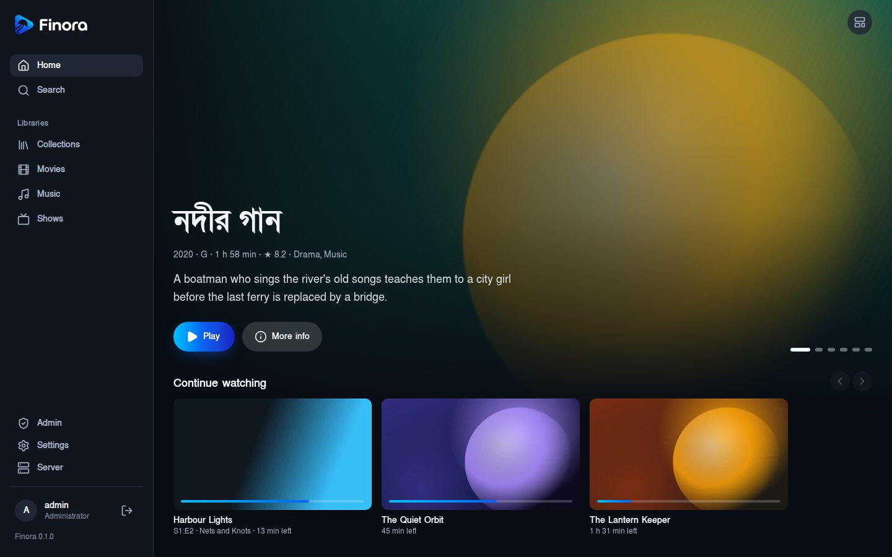
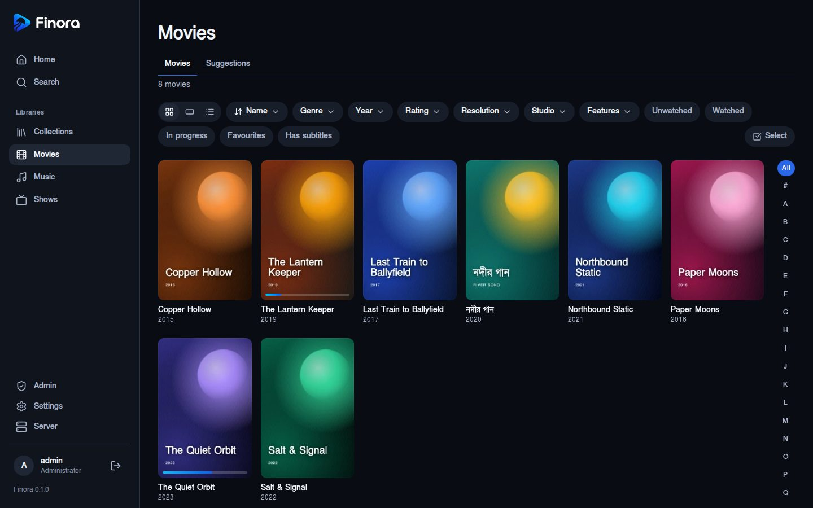
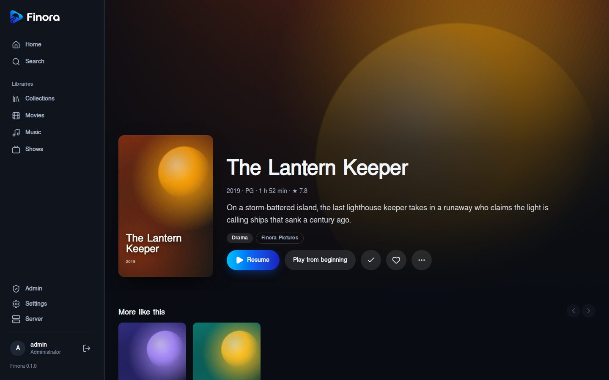
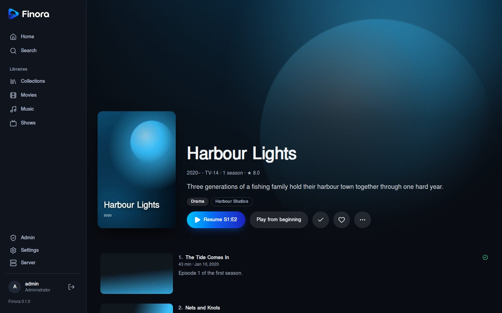
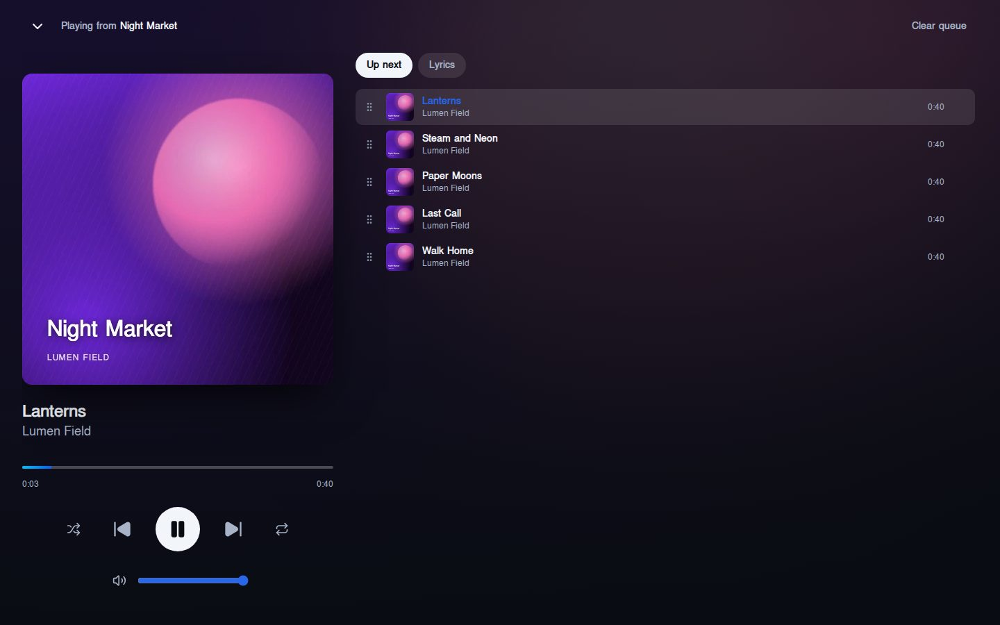
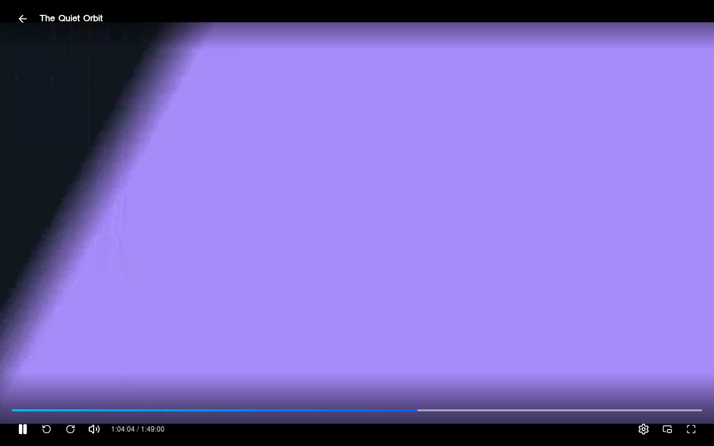
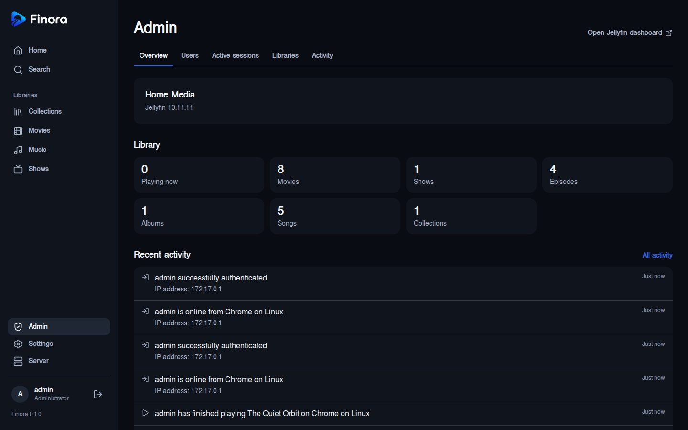
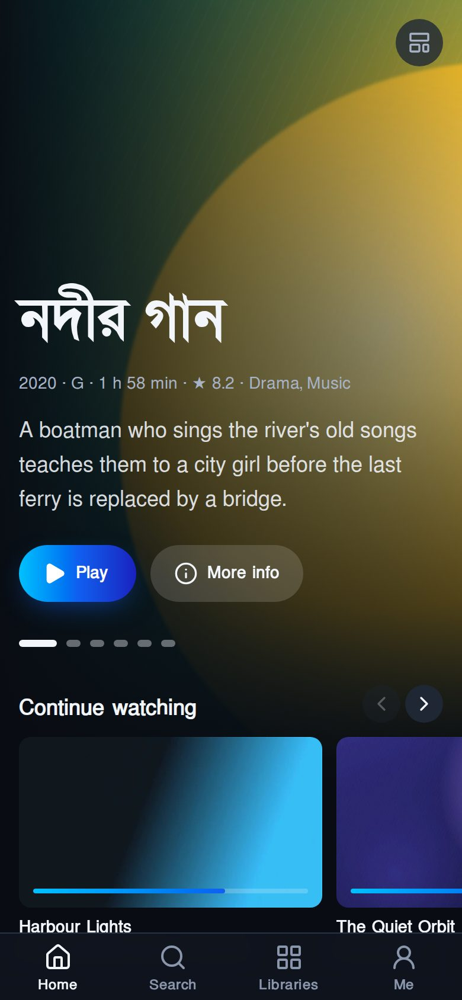
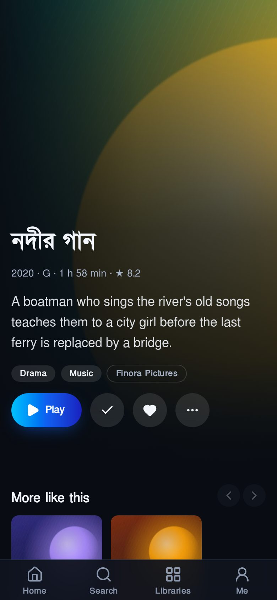

<p align="center">
  
</p>

# Finora

A fresh, fast web client for [Jellyfin](https://jellyfin.org). Finora replaces
the default Jellyfin web interface for everyday watching and listening, with a
cinematic design, Bengali-friendly typography and a few things Jellyfin lacks,
such as a built-in subtitle finder.

Finora talks to your existing Jellyfin server. It needs no server plugins and
never stores your media.

## Screenshots



| | |
| --- | --- |
|  |  |
|  |  |
|  |  |

<p align="center">
  
  
</p>

The titles and artwork are made up for these screenshots
([web/scripts/screenshots](web/scripts/screenshots)); your library shows your
own media.

## Features

- **Browse everything:** home with Continue Watching, Next Up, Continue
  Listening and Recently Added (three layouts, rows you can reorder or
  hide), every library type including folder libraries, poster, thumbnail
  and list views, filters (genre, year, rating, resolution, studio, tag,
  features), multi-select with bulk actions, movie suggestions, upcoming
  episodes, rich detail pages with trailers, and search with suggestions.
- **Playlists and collections:** add from any item or a selection, reorder
  by dragging, rename, and remove.
- **Video player:** plays files untouched whenever the browser can (important
  on servers without hardware transcoding), falls back to HLS when needed,
  audio and subtitle switching, styled ASS/SSA subtitles, subtitle size,
  colour and timing, seek-bar thumbnails, a chapter menu, skip intro
  (button or automatic), next-episode autoplay, keyboard shortcuts and
  media keys.
- **Music:** persistent player with a queue (reorder, play next, shuffle,
  repeat), full-screen now playing, synced lyrics and Instant Mix.
- **Subtitle finder:** search Addic7ed, SubDL and OpenSubtitles from any
  movie or episode; the subtitle is stored beside the video in Jellyfin and
  is usable immediately. Optionally, a nightly job fetches missing
  subtitles across the library, accepting only certain matches.
- **Admin console:** users, library access, permissions, parental controls,
  viewing times, stream and bitrate limits, devices, Quick Connect for a
  user, active sessions, library scans, site-wide announcements, and
  metadata, image and identify tools on every detail page.
- **Settings:** languages, subtitle mode and appearance, streaming quality,
  theme (dark/light), date format, home rows and libraries, profile
  picture, password and Quick Connect.
- **Sign-in:** password, Quick Connect, a user picker with avatars, PIN
  password reset, and Google sign-in for admins.
- **Installable:** add Finora to a phone or desktop as an app when it is
  served over HTTPS.
- **TV mode:** remote-control navigation with the arrow keys and Back.
- **Extras:** theme songs and videos on detail pages, copy a stream link
  for VLC, an admin overview and activity log, and subtitle settings for
  many users at once.

## How it fits together

| Part | What it is | Required |
| --- | --- | --- |
| Finora Web (`web/`) | React app, built to static files and served by Nginx or any web server | Yes |
| Finora API (`api/`) | Small Go service with SQLite for the subtitle finder, announcements and Google sign-in for admins | No |
| Jellyfin | Your existing server (10.10 or newer; developed against 10.11) | Yes |

The browser talks to Jellyfin directly, so video never passes through Finora.

## Quick start (development)

```bash
cd web
pnpm install
cp public/config.example.json public/config.json   # set jellyfinUrl
pnpm dev
```

Optional API:

```bash
cd api
go run ./cmd/finora-api        # prints a one-time setup code on first start
```

Then set `apiUrl` in `web/public/config.json` and finish setup under
**Admin → Finora**.

## Deploying

See the [deployment guide](docs/deployment.md). It covers serving Finora over
HTTPS or plain HTTP, the optional API, Docker and systemd, and the browser
rules that decide which combination works.

## Documentation

- [Product concept](docs/concept.md): scope, architecture and phases
- [UI plan](docs/ui-plan.md) and [design system](DESIGN.md)
- [Finora API](api/README.md) and [Finora Web](web/README.md)
- [Knowledge base](.knowledge/index.md): decisions and verified Jellyfin
  behaviour

## License

[MIT](LICENSE). The SolaimanLipi font is under the SIL Open Font License
(`web/src/assets/fonts/OFL.txt`). Styled subtitles use
[JASSUB](https://github.com/ThaUnknown/jassub) (LGPL-2.1-or-later and
others), loaded as a separate module only when needed. Vendored agent skills
keep their own licences (`.claude/skills/VENDORED.md`).
