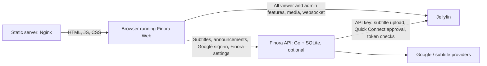

# Finora — Product Concept

## 1. What Finora is

Finora is a fresh web client for Jellyfin. It replaces the default Jellyfin
web UI for everyday use on a small, self-hosted family-and-friends server.

The goal is simple:

- **Viewers** get the same features as the official Jellyfin web client, with
  a cleaner, faster, more polished interface.
- **Admins** get the everyday management tasks — mainly user management —
  inside Finora. Everything else stays in the official Jellyfin dashboard,
  which Finora links to.

Finora has two independent parts:

- **Finora Web** — a React single-page app, built to a static `dist/` folder
  and served by Nginx or any static file server. It talks directly to
  Jellyfin and works on its own.
- **Finora API** — an optional, small Go service with SQLite. It exposes only
  a JSON API for features Jellyfin does not have: the subtitle finder,
  announcements, Google sign-in for admins, and Finora-wide settings.

Jellyfin stays the source of truth for media, users, permissions and watch
state. Finora never copies Jellyfin's data into its own database.

## 2. Target environment

Finora is designed around a real server rather than an imaginary one. Facts
below were taken from the reference server's API in October 2026.

| Aspect | Current state | Consequence for Finora |
| --- | --- | --- |
| Jellyfin version | 10.11.x | Baseline is 10.11; no compatibility code for older versions |
| Libraries | Movies, TV Series, Music, Collections, three Home Videos libraries | All of these need first-class browsing |
| Size | ~4,200 movies, ~195 series / ~14,000 episodes, ~5,500 songs / ~480 albums, ~300 collections | Server-side paging, sorting and filtering everywhere |
| Home Videos libraries | Folder-based (natok, kids content, stand-up specials) | Folder navigation is required, not optional |
| Users | ~34 accounts, family and friends, 3 admins | User management is the core admin feature |
| Login screen | Every user is hidden from the login screen | Username + password login; no user picker by default |
| Quick Connect | Enabled | Support both signing in with a code and approving codes |
| Library access | Most users have per-library access, not "all libraries" | Per-user library access is a frequent admin task |
| Transcoding | CPU only, no hardware acceleration | Direct play must be maximised; transcoding is expensive |
| Media formats (sample) | Mostly H.264 + AAC, some AV1/HEVC/VP9; subtitles almost all SRT | Direct play works for most files; ASS/PGS rendering is lower priority |
| Trickplay | Enabled for Movies, TV, Stand-up | Seek-bar thumbnail previews are worth building early |
| Intro detection | No intro/segment plugin installed | "Skip intro" UI is built against the media-segments API but hidden when no segments exist |
| Clients in use | Jellyfin Web is the main video client; a desktop music client is the most used music client; Android, iOS and Android TV apps also in use | Desktop-first, good on phones, and music is a real use case |
| Announcements | Admins currently inject a site-wide banner through custom CSS | Finora needs a proper announcement banner |
| Network | Jellyfin is reached over plain HTTP at one public IP and port (router port forward); the owner does not publish the home IP in DNS | Finora must work completely over plain HTTP, with a single Jellyfin address (see 7.2 and 7.3) |
| Subtitle storage | "Save subtitles with media" is on for every library; Jellyfin serves HTTP range requests on downloads | Subtitles uploaded through the API land beside the video files; file hashes can be computed without file access |
| CORS | Jellyfin answers `Access-Control-Allow-Origin: *` | Finora Web can call Jellyfin directly from the browser |

## 3. Principles

1. **Feature parity for viewers.** If the official web client can do it for a
   regular user, Finora should be able to do it too, unless it is explicitly
   listed as out of scope.
2. **Jellyfin is the source of truth.** Use Jellyfin's API and its data. Never
   invent metadata, statistics, or settings that the server does not provide.
3. **Direct play first.** Every transcode costs CPU on a small server. Finora
   should only ask the server to transcode when the browser truly cannot play
   a file.
4. **Media never goes through Finora.** Video, audio and images flow directly
   between the browser and Jellyfin. The Finora API handles only small JSON
   requests, so it can sit behind a CDN or proxy that forbids video.
5. **Works over HTTP and HTTPS.** Both deployment profiles in section 7.2 are
   first-class.
6. **Fast with large libraries.** Page, filter and sort on the server. Load
   artwork at the size it is displayed.
7. **Hide what does not apply.** Sections without data (no trailers, no
   segments, no lyrics) disappear instead of showing broken buttons.
8. **Small and self-hosted.** A static folder, plus an optional Go binary with
   a SQLite file. No tracking, no third-party services except ones the operator
   enables (Google sign-in, subtitle providers).

## 4. Users and roles

| Role | Who | What they need |
| --- | --- | --- |
| Viewer | Family members and friends | Find something to watch or listen to, continue where they left off, reliable playback on laptop, phone and TV browser |
| Admin | Server owner and co-admins | Add and manage users, control library access, see who is watching, run a library scan, post announcements |

Viewer permissions come from Jellyfin. Finora hides actions a user is not
allowed to perform, and Jellyfin still enforces them.

## 5. Feature scope

Features are grouped into three tiers:

| Tier | Label in tables | Meaning |
| --- | --- | --- |
| Tier 1 | Must | The first usable release |
| Tier 2 | Should | Completes parity with the official client |
| Tier 3 | Could | Optional extras |

Delivery order is in section 8; the UI approach is in
[ui-plan.md](ui-plan.md).

### 5.1 Sign-in and session

| Priority | Feature |
| --- | --- |
| Must | Username + password login against Jellyfin, remember me, logout |
| Must | Sign in with Quick Connect (show a code, wait for approval) |
| Must | Restore session on reload; handle expired or revoked tokens |
| Must | Show the server's login disclaimer if one is set |
| Must | Admin console unlock rules per deployment profile (see 7.5) |
| Should | Google sign-in for admins, built on Quick Connect (needs the Finora API on HTTPS; see 7.5) |
| Should | User picker with avatars when the server has visible users |
| Should | Forgot-password flow (Jellyfin PIN reset) |

### 5.2 Home

| Priority | Feature |
| --- | --- |
| Must | Continue Watching (movies and episodes with progress) |
| Must | Next Up (next episode of series in progress) |
| Must | Recently Added, one row per library |
| Must | My Media tiles for each library the user can access |
| Must | Announcement banner (see 5.10) |
| Should | Continue Listening (recent albums / tracks) |
| Should | Home section order and hidden libraries, using the user's Jellyfin home settings |
| Could | Featured hero rotating through recently added items |

### 5.3 Browsing libraries

Shared by all library types:

| Priority | Feature |
| --- | --- |
| Must | Poster grid with paging or infinite scroll |
| Must | Sort by name, date added, release date, rating, runtime, play count, random |
| Must | Filters: played, unplayed, resumable, favourites, genre, year, official rating, resolution (SD/HD/4K), has subtitles |
| Must | A–Z jump bar |
| Must | Remember sort, filter and view choices per library |
| Should | View modes: posters, thumbnails, list |
| Should | Filters: tags, studios, video features (3D, HDR), series status |
| Should | Multi-select with bulk actions (mark played, favourite, add to playlist or collection) |

Per library type:

| Library | Priority | Views |
| --- | --- | --- |
| Movies | Must | Movies, Collections, Favourites, Genres |
| Movies | Should | Suggestions ("Because you watched…") |
| TV Series | Must | Shows, Genres, Favourites; Series → Season → Episode navigation |
| TV Series | Should | Upcoming episodes, Networks/Studios, Episodes view |
| Home Videos | Must | Folder navigation with breadcrumbs, play folder contents in order |
| Music | Must | Albums, Album Artists, Artists, Songs, Genres, Playlists |
| Collections | Must | All collections, collection detail with its items |
| Playlists | Must | Playlist list and detail, play, shuffle |

### 5.4 Item detail pages

| Priority | Feature |
| --- | --- |
| Must | Backdrop, logo or title, poster, year, runtime, official rating, community/critic rating where present |
| Must | Overview, genres, studios, tags |
| Must | Play / Resume, Play from beginning, Shuffle (series, seasons, collections, artists) |
| Must | Mark played/unplayed, favourite |
| Must | Seasons and episodes for series, with watched state and progress |
| Must | Version picker when an item has multiple files |
| Must | Audio and subtitle track pickers before playback |
| Must | Cast and crew row; person page with filmography |
| Must | Genre, studio and tag pages |
| Must | Media info panel (container, codecs, resolution, bitrate, tracks) |
| Should | Trailers (local and remote) |
| Should | Special features / extras |
| Should | "More like this" |
| Should | External links (IMDb, TMDb, etc.) |
| Should | Add to playlist, add to collection |
| Should | Download original file (if the user is allowed to) |
| Should | Album and artist pages with track lists |
| Should | Find subtitles (see 5.11) |
| Could | Copy stream link |

Admin-only actions on detail pages are listed in section 5.9.

### 5.5 Search

| Priority | Feature |
| --- | --- |
| Must | Global search with debounced input and cancellation of stale requests |
| Must | Results grouped by type: movies, series, episodes, people, albums, artists, songs, collections |
| Must | Keyboard shortcut to open search and keyboard navigation of results |
| Should | Suggestions shown before the user types |

### 5.6 Video playback

Playback is the most important and the hardest part of Finora.

| Priority | Feature |
| --- | --- |
| Must | Playback negotiation through Jellyfin's PlaybackInfo with an accurate browser device profile |
| Must | Direct play when the browser supports the file; otherwise remux (direct stream); transcode only as a last resort |
| Must | HLS playback via `hls.js` (native HLS on Safari) |
| Must | Play, pause, seek, volume, mute, fullscreen |
| Must | Resume position; report start, progress and stop to the server |
| Must | Audio track switching |
| Must | Subtitle switching for SRT/VTT (text-based, rendered by Finora) |
| Must | Next-episode overlay with countdown and autoplay (user setting) |
| Must | Keyboard shortcuts, touch controls, auto-hiding controls |
| Must | Clear error messages when playback fails |
| Must | Quality / max bitrate selection |
| Must | Trickplay thumbnails on the seek bar |
| Should | Subtitle styling (size, colour, background, position) and offset |
| Should | ASS/SSA subtitle rendering (JASSUB) and image-based subtitles (PGS) via burn-in fallback |
| Should | Chapters on the seek bar and chapter menu |
| Should | Skip Intro / Skip Credits / Skip Recap when media segments exist |
| Should | Playback speed |
| Should | Picture-in-picture |
| Should | Media Session API (media keys, OS and lock-screen controls) |
| Should | Playback info overlay (direct play vs transcode, reason, bitrate) |
| Could | Theme music / theme videos on detail pages |

### 5.7 Music playback

| Priority | Feature |
| --- | --- |
| Must | Persistent now-playing bar that survives navigation |
| Must | Play queue: view, reorder, remove, clear, play next, add to queue |
| Must | Shuffle and repeat (off / all / one) |
| Must | Gapless-feeling transitions between tracks (preload the next track) |
| Must | Full-screen now-playing view |
| Must | Report playback to the server (play counts, resume) |
| Must | Media Session API (media keys, OS and lock-screen controls) |
| Should | Lyrics, synced where available |
| Should | Instant Mix |
| Should | Create and edit playlists |

### 5.8 User settings

Viewer settings are stored in Jellyfin (user configuration and display
preferences) so they follow the user across devices. Only client-only choices
such as theme are stored locally.

| Priority | Feature |
| --- | --- |
| Must | Preferred audio language, subtitle language and subtitle mode |
| Must | Max streaming bitrate |
| Must | Autoplay next episode on / off |
| Must | Remember audio and subtitle choices per series |
| Must | Theme (dark / light / system) |
| Must | Change password |
| Must | Upload / remove profile picture |
| Should | Subtitle appearance |
| Should | Home section order, libraries hidden from home and "latest" rows |
| Should | Display language and date format |
| Should | Skip-segment behaviour (show button / skip automatically / do nothing) |
| Should | Authorise a Quick Connect code from inside Finora (log in a TV) |
| Could | Easy PIN for in-network sign-in |

### 5.9 Admin

Admin features in Finora are deliberately limited to what the admins do
often. A clear "Open Jellyfin Dashboard" link handles everything else
(transcoding, networking, plugins, scheduled tasks, logs, metadata settings).

The admin console talks directly to Jellyfin with the admin's own session.
Items marked "API" need the Finora API and are hidden without it. Who can
unlock the console is described in 7.5.

| Priority | Feature |
| --- | --- |
| Must | User list: name, avatar, admin badge, disabled state, last active, online now |
| Must | Create user (name, password, library access in one step) |
| Must | Edit user: rename, reset password, enable / disable, admin on / off |
| Must | Library access: all libraries or a selected set |
| Must | Permissions: media playback, transcoding (audio / video), remuxing, downloads, deleting media, remote (outside LAN) access |
| Must | Delete user with confirmation |
| Must | Active sessions: who is watching what, client, direct play or transcode, progress |
| Must | Stop a session or send it a message |
| Must | Scan all libraries / scan one library |
| Should | API: announcement banner editor (see 5.10) |
| Should | API: Finora settings — Jellyfin URL, API key, allowed origins, Google client, session lifetime |
| Should | API: admin allowlist for Google sign-in (email → Jellyfin admin user) |
| Should | API: subtitle provider settings, permissions and quotas (see 5.11) |
| Should | Parental controls: maximum rating, blocked tags, access schedule |
| Should | Limits: max simultaneous streams, max streaming bitrate per user |
| Should | Log a user out of all devices |
| Should | Approve Quick Connect codes for other users |
| Should | Item admin actions on detail pages: refresh metadata, identify, edit metadata, edit images, delete item |
| Could | Activity log viewer |
| Could | Simple server overview: version, library counts, pending restart |

### 5.10 Announcement banner

The server currently shows a site-wide notice by injecting text through
Jellyfin's custom CSS. Finora replaces this with a real banner:

- Shown at the top of every page for all users, dismissible per session.
- Admins create, edit, schedule (start / end date) and remove announcements in
  the admin console.
- Stored in the Finora API's SQLite database and read through a public
  endpoint. Requires the Finora API; without it, no banner is shown.

### 5.11 Subtitle finder

Jellyfin's OpenSubtitles plugin gives a poor experience and the SubBuzz plugin
no longer works. Finora brings its own subtitle finder, based on the provider
research in the author's `subtitle-fetcher` project. It requires the Finora
API.

**User flow**

1. On a movie or episode page, or from the player's subtitle menu, the user
   clicks "Find subtitles".
2. A dialog shows results from all enabled providers, merged and ranked, in
   the user's preferred subtitle language (changeable).
3. Each result shows the provider, release name and badges: "Exact sync"
   (file-hash match), "Matches your file" (release-name match), hearing
   impaired, machine translated, forced.
4. The user picks one. Within seconds it is selected in the player and
   available to every other user.

| Priority | Feature |
| --- | --- |
| Should | Search, rank and download as described above, for movies and episodes |
| Should | Subtitle is usable immediately, before Jellyfin has indexed it |
| Should | Subtitle is stored by Jellyfin beside the video file, so every Jellyfin client sees it |
| Should | Other Finora users get the downloaded subtitle selected by default |
| Should | Replace or remove a subtitle that was added through Finora |
| Should | Admin settings: enabled providers and order, credentials, who may download (all users or admins), per-user daily limit |
| Should | Provider quota and cooldown status visible to admins |
| Could | Admin tool to set Jellyfin subtitle preferences (mode, language) for many users at once |
| Could | Library-wide automatic fetching (the `subtitle-fetcher` scheduler) |

**How it works**

- **Metadata from Jellyfin, not filenames.** The API reads title, year,
  series, season, episode, IMDb/TMDb IDs, file name and size from Jellyfin.
- **File hash without file access.** The OpenSubtitles hash needs the first
  and last 64 KB of the video. The API fetches them with two HTTP range
  requests to Jellyfin's download endpoint (verified on the reference server).
- **Providers** (ported from `subtitle-fetcher`, pluggable):

  | Provider | Use | Notes |
  | --- | --- | --- |
  | Addic7ed | Episodes only | Anonymous; global pacing (~3 s between requests) and cooldown on throttling |
  | SubDL | Movies and episodes | Anonymous scraping of zip packs; detects the daily per-IP cap |
  | OpenSubtitles.com | Movies and episodes | REST API key, optional account login; hash and IMDb-ID queries; tracks remaining quota |

  Podnapisi, Gestdown and YTS adapters exist in `subtitle-fetcher` but stay
  off unless reachable.
- **Processing** (also ported): zip / gzip extraction with episode-aware
  member choice in season packs, foreign-language filename filtering,
  plausibility checks (real cue timings, fake stub detection), conversion to
  UTF-8.
- **Ranking** (ported): file-hash match first, then release-name overlap with
  the Jellyfin file name, matching resolution, and a preference for
  non-machine-translated, non-forced, non-hearing-impaired uploads.
- **Delivery in three steps:**
  1. The API stores the subtitle in its data directory and records it in
     SQLite (item, media source, language, provider, release, who downloaded
     it, when).
  2. The API uploads it to Jellyfin with `POST /Videos/{itemId}/Subtitles`
     using the API key. Jellyfin saves it beside the video (the library
     option "save subtitles with media" is on for every library on the
     reference server) and queues a high-priority refresh of that item.
  3. Until Jellyfin lists the new subtitle stream, Finora's player loads the
     subtitle from the API as a WebVTT text track. Once Jellyfin has indexed
     it, Finora switches to Jellyfin's own stream.
- **Default for other users.** When a viewer opens an item that has a
  Finora-added subtitle in their preferred language and has not chosen a
  track themselves, Finora selects it. Other Jellyfin apps follow each user's
  Jellyfin subtitle settings; the optional admin tool above helps there.
- **Replacing** a subtitle deletes the previous Finora-added stream with
  `DELETE /Videos/{itemId}/Subtitles/{index}` before uploading the new one.
- **No FTP or file-share access is needed.** The upload API writes the file
  beside the video.

### 5.12 Cross-cutting UX

| Priority | Feature |
| --- | --- |
| Must | Responsive layout: desktop first, fully usable on phones and tablets |
| Must | Loading skeletons, empty states, error states with retry |
| Must | Keyboard accessible menus, dialogs and controls, visible focus |
| Must | Reduced-motion support |
| Must | Toast notifications for actions |
| Should | Installable as a PWA (home-screen icon, full-screen launch) when served over HTTPS |
| Could | TV / remote-friendly navigation (arrow-key focus) |

### 5.13 Out of scope

- Live TV, EPG guide and DVR recordings (no Live TV on the server).
- Books, comics and audiobooks readers (no such libraries).
- Photo slideshow (no photo library).
- Full server administration: transcoding, networking, plugins, scheduled
  tasks, metadata providers, backups, logs. Use the Jellyfin dashboard.
- SyncPlay (watch together). Revisit after the first release.
- Remote control of other Jellyfin clients ("play on…"). Revisit after the
  first release.
- Chromecast.
- Offline downloads for playback inside Finora.
- Proxying media or Jellyfin API traffic through the Finora API.
- Finora's own user accounts for viewers.

## 6. Brand

The logo and wordmark are vectorised in `draft_resources/logo/svg/`:

| File | Use |
| --- | --- |
| `finora-mark.svg` | App icon, favicon, compact header |
| `finora-wordmark.svg` | Wordmark on light backgrounds |
| `finora-wordmark-white.svg` | Wordmark on dark backgrounds |
| `finora-logo.svg` | Stacked mark + wordmark |

Colours sampled from the logo:

| Token | Value | Use |
| --- | --- | --- |
| Cyan | `#03C1FD` | Gradient start, highlights |
| Blue | `#105FF0` | Primary actions, active states |
| Indigo | `#1A20BF` | Gradient end |
| Navy | `#032553` | Wordmark, dark surfaces |

Dark theme is the default; light theme is supported through the same
semantic tokens.

The UI typeface is **SolaimanLipi** (Thin 100, Regular 400, Bold 700;
version 2.002, SIL Open Font License 1.1). It covers both Latin and Bengali,
which matters because the library has Bengali titles. It is self-hosted as
WOFF2 with its licence alongside.

Visual direction: cinematic artwork for browsing, calm and compact layouts for
settings and admin, no decorative noise.

## 7. Technical architecture

### 7.1 Components and traffic



Rules:

- **Finora Web works without the Finora API.** Browsing, playback, music,
  user settings and the admin console talk directly to Jellyfin, like any
  other Jellyfin client.
- **The Finora API is optional.** It adds the subtitle finder,
  announcements, Google sign-in for admins and Finora-wide settings. When it
  is not configured or not reachable, these features are hidden and
  everything else keeps working.
- **No media through the API.** The API only handles small JSON requests and
  subtitle text, so it can sit behind a CDN proxy that forbids video (for
  example Cloudflare's orange cloud), hiding the origin IP.
- **The API does not serve the frontend.**

### 7.2 One Jellyfin address

Jellyfin has exactly one configured address, used by browsers and by the
Finora API alike — for example `http://<public-ip>:<port>` or
`https://jellyfin.example.com`.

If the Finora API runs on the same LAN as Jellyfin and the address is the
router's public IP, the router must support NAT loopback (hairpin NAT). The
deployment guide explains how to check this.

### 7.3 Deployment profiles

Browsers block requests from an HTTPS page to `http://` addresses. A page
loaded over HTTP may call both HTTP and HTTPS addresses.

| | HTTPS profile | HTTP profile |
| --- | --- | --- |
| Finora Web | `https://finora.example.com` | `http://<public-ip>:<port>` |
| Jellyfin | Must be HTTPS | HTTP or HTTPS |
| Finora API (optional) | Must be HTTPS | HTTP or HTTPS; HTTPS needed for Google sign-in |
| Admin console sign-in | Jellyfin admin username + password, or Google | Google only (see 7.5) |
| PWA / install prompt | Available | Not available (browsers require HTTPS) |
| Security | Encrypted end to end | Viewer passwords, tokens and media travel unencrypted — the same as using Jellyfin over HTTP today |

Finora Web compares its own scheme with the configured Jellyfin and API URLs
at startup. If the page is HTTPS and either URL is HTTP, it shows a clear
configuration error instead of failing silently.

### 7.4 Configuration

**Finora Web** reads a runtime `config.json` next to `index.html`, so one
build works in any deployment:

| Key | Required | Example |
| --- | --- | --- |
| `jellyfinUrl` | Yes | `http://<public-ip>:<port>` |
| `apiUrl` | No | `https://finora-api.example.com` |

**Finora API** stores its settings in SQLite. Environment variables can
pre-seed or override them for container deployments.

| Setting | Notes |
| --- | --- |
| Jellyfin URL | The same single address as in `config.json` |
| Jellyfin API key | Never returned to any client |
| Allowed Finora Web origins (CORS) | Exact origins; also tell the API whether the frontend is HTTP or HTTPS |
| Google client ID / secret | Secret never returned to any client |
| Admin allowlist | Google email → Jellyfin admin user |
| Google admin session lifetime | Default 12 hours |
| Subtitle providers, order, credentials | Credentials never returned to any client |
| Subtitle permissions and limits | Who may download, per-user daily limit |

**First-run setup.** An unconfigured Finora API prints a one-time setup code
to its log. The setup screen in Finora Web requires that code before it saves
the Jellyfin URL and API key. After setup, only Jellyfin admins can change
settings.

### 7.5 Authentication

**Viewers** sign in with their Jellyfin username and password, or Quick
Connect, directly against Jellyfin. Finora Web keeps the Jellyfin access
token; passwords are never stored. The Finora API accepts the same token for
user features (subtitle finder) and validates it by asking Jellyfin who the
token belongs to.

**Admins** use the admin console with their own Jellyfin session; admin
pages call Jellyfin's admin endpoints directly. Finora never stores admin
passwords. How an admin session may be obtained depends on the profile:

| Profile | Jellyfin admin username + password | Google sign-in |
| --- | --- | --- |
| HTTPS | Allowed | Optional (needs the Finora API) |
| HTTP | Signs in as a viewer only; the admin console stays locked | Required to unlock the admin console (needs the Finora API on an HTTPS address) |

On an HTTP deployment without a Finora API on HTTPS, Finora has no admin
console; admins use the Jellyfin dashboard.

**Google sign-in flow** (no password involved, built on Jellyfin Quick
Connect):

1. Finora Web starts a Quick Connect request with Jellyfin and keeps the
   secret in the browser.
2. The browser goes to the Finora API's Google sign-in endpoint (HTTPS),
   carrying only the short Quick Connect code.
3. After Google sign-in, the API verifies the ID token and looks up the email
   in the admin allowlist to find the Jellyfin admin user.
4. The API approves the Quick Connect code for that user with the API key
   (`POST /QuickConnect/Authorize?code=…&userId=…`).
5. The API redirects back to Finora Web, which completes Quick Connect and
   receives a normal Jellyfin session for the admin.
6. The API records the session's device and revokes it in Jellyfin
   (`DELETE /Devices?id=…`) when the configured lifetime ends. Finora Web
   uses a fresh, unique device ID for every Google sign-in, so revoking it
   never logs out the admin's other sessions. Finora Web asks the API whether the current
   session came from Google before unlocking the console on HTTP.

Google requires HTTPS redirect URIs and rejects raw IP addresses (only
`localhost` is exempt). The redirect URI belongs to the Finora API, so only
the API needs an HTTPS hostname; Finora Web can stay on `http://<ip>:<port>`.

**Security notes for operators** (also in the deployment guide):

- On HTTP, Google sign-in keeps the admin password off the network, but the
  resulting Jellyfin token still travels unencrypted during the session. The
  automatic revocation limits how long a captured token is useful.
- The HTTP rule is a Finora guard rail, not a security boundary: Jellyfin
  itself still accepts admin passwords on its own port. Use long, unique
  passwords for Jellyfin admin accounts.
- Recommended: give every person, including admins, a non-admin Jellyfin
  account for daily viewing, and use admin accounts only through Google
  sign-in.
- On HTTP the Finora Web files are served unencrypted and could be tampered
  with on the network path — the same exposure as Jellyfin's own web client
  over HTTP. HTTPS is the only full fix.
- The Finora API rate-limits setup and sign-in attempts and logs admin
  actions without secrets.

### 7.6 Finora Web (frontend)

| Concern | Choice |
| --- | --- |
| Language | TypeScript (strict) |
| UI | React |
| Build | Vite, output to `dist/` |
| Routing | React Router (SPA fallback to `index.html`) |
| Server state | TanStack Query |
| Jellyfin API | `@jellyfin/sdk` (official, typed) |
| Finora API | Typed client matching the API's OpenAPI document |
| Styling | Tailwind CSS with design tokens |
| Accessible primitives | Radix UI (dialogs, menus, popovers) |
| Toasts | Sonner |
| Bottom sheets (phones) | Vaul |
| Command palette / search | cmdk |
| Virtualised grids | Virtuoso |
| Animation | Motion; CSS transitions for simple cases |
| Client state (player, queue) | zustand |
| Drag to reorder | dnd kit |
| Variant classes | cva + clsx |
| Forms | React Hook Form + Zod |
| Icons | Lucide |
| Video | HTML5 video + `hls.js`; JASSUB for ASS subtitles |
| Tests | Vitest, React Testing Library, Playwright |
| Package manager | pnpm |

Feature-oriented folders: `src/app`, `src/api` (Jellyfin and Finora API
clients), `src/features/{auth,home,library,item,search,player,music,settings,admin,subtitles}`,
`src/components`, `src/styles`. UI components never call either API
directly; they use hooks from the feature or `api` layer. Features that need
the Finora API check its availability through one shared hook.

### 7.7 Finora API (backend)

| Concern | Choice |
| --- | --- |
| Language | Go (current stable) |
| HTTP | Standard library `net/http` with method/path routing |
| Database | SQLite via `modernc.org/sqlite` (pure Go, static binary) |
| Migrations | Embedded SQL files, applied at startup |
| Google sign-in | `golang.org/x/oauth2` + OIDC ID-token verification |
| API contract | OpenAPI document kept in the repository |
| Tests | `go test`, with a fake Jellyfin server and recorded provider responses |
| Packaging | Single binary, systemd unit, and a small container image |

Endpoint groups (all under `/api/v1`, JSON only):

| Group | Auth | Purpose |
| --- | --- | --- |
| `GET /public/config` | None | Enabled features and sign-in methods |
| `GET /announcements` | None | Active announcements |
| `/setup/*` | Setup code | First-run configuration |
| `/auth/google/*` | Varies | Start, callback, session check |
| `/subtitles/*` | Jellyfin user token | Search, download, list Finora-added subtitles, serve WebVTT, replace, remove |
| `/admin/*` | Jellyfin admin token (Google-issued on HTTP) | Finora settings, admin allowlist, announcements, subtitle providers and quotas |
| `GET /healthz` | None | Liveness and Jellyfin reachability |

CORS allows only the configured Finora Web origins. Requests carry the
Jellyfin token in the `Authorization` header; no cookies.

### 7.8 Playback strategy

The reference server has no hardware transcoding, so the device profile Finora
sends to PlaybackInfo must be accurate:

1. Detect what the browser can decode (`MediaSource.isTypeSupported`,
   `canPlayType`, and `navigator.mediaCapabilities`) for H.264, HEVC, AV1,
   VP9, AAC, Opus, AC-3/E-AC-3, and containers.
2. Build the Jellyfin device profile from those results.
3. Prefer direct play, then direct stream (remux), then transcode.
4. Deliver SRT/VTT subtitles as external text tracks; never burn in text
   subtitles. Burn-in is only a fallback for image subtitles.
5. Show the playback method and reason in the info overlay so problems can be
   diagnosed.

### 7.9 Repository layout

```text
finora/
├── web/        React app (Vite, pnpm)
├── api/        Go service
├── deploy/     Nginx config, systemd unit, container files, examples
└── docs/       Concept, deployment guide, decisions
```

### 7.10 Deployment

- **Finora Web:** `pnpm build` produces `web/dist/`. Serve it with Nginx (or
  any static server) with SPA fallback to `index.html`, and place
  `config.json` next to it.
- **Finora API (optional):** run the binary under systemd or as a container,
  with a data directory for the SQLite file and stored subtitles.
- A small LXC container can host both, each reachable through its own router
  port forward or reverse proxy. The API can also be published separately,
  for example behind a CDN proxy on an HTTPS hostname.
- A `docker-compose.yml` example runs Nginx with `dist/` and the API side by
  side.
- The deployment guide covers both profiles, NAT loopback, Google OAuth client
  setup, and backups of the API data directory.

## 8. Delivery phases

Each phase ends with something usable against the real server. Phases 0–5
need only Finora Web; the Finora API arrives in phase 6.

| Phase | Content | Done when |
| --- | --- | --- |
| 0. Foundation | Monorepo scaffold (`web/`, `api/` placeholder), lint/format/test setup, runtime `config.json`, Jellyfin SDK client, scheme check, design tokens, app shell | Finora Web loads its config, reaches Jellyfin, and shows the server name and version |
| 1. Sign-in | Login, Quick Connect, session restore, logout, route guards | Any user can sign in and out reliably |
| 2. Browse | Home rows, library grids with filters/sort/paging, folder navigation, item detail, series/season/episode, person/genre pages, search | A user can find any item in any library |
| 3. Video player | PlaybackInfo + device profile, direct play/stream/transcode, tracks, subtitles, resume, progress reporting, next episode, trickplay | Movies and episodes play reliably on Chrome, Firefox and Safari with correct resume state |
| 4. Music | Album/artist/song views, persistent player, queue, shuffle/repeat, playlists | A user can listen to music while browsing |
| 5. Settings | User preferences, profile picture, password change | Settings persist on the server and affect playback |
| 6. Finora API and admin | Go service with SQLite, migrations, first-run setup, settings, Google sign-in via Quick Connect, session revocation, admin console (users, library access, permissions, sessions, library scan), announcements | Admins sign in with Google on the HTTP deployment and no longer need the Jellyfin dashboard for daily tasks |
| 7. Subtitles | Port providers and processing from `subtitle-fetcher`, search dialog, upload to Jellyfin, immediate WebVTT fallback, default selection, replace/remove | A user can find a subtitle and every user sees it right away |
| 8. Parity and polish | Remaining "Should" items, PWA, accessibility pass, performance pass on the full library | Finora replaces the official web client for daily use |
| 9. Release | Container images, deployment guide for both profiles, screenshots, tests for critical flows | Someone else can deploy it from the README |

## 9. Open decisions and checks

| Topic | Options / what to verify | Decide in |
| --- | --- | --- |
| ~~Quick Connect approval with the API key~~ | Resolved from 10.11.11 source: API keys get the Administrator role, so `GetUserId` accepts any `userId`, and `AuthorizeRequest` signs that user in directly | Done |
| ~~Session revocation~~ | Resolved from source: `DELETE /Devices?id=…` logs out the device's sessions and deletes its access token | Done |
| Default subtitle language for searches | User's Jellyfin subtitle language vs a Finora setting | Phase 7 |
| Subtitle finder access | All users vs admins only (setting default) | Phase 7 |
| Finora API OpenAPI workflow | Spec-first with code generation vs handwritten spec | Phase 6 |
| Subtitle renderer | Native text tracks vs a custom overlay for consistent styling | Phase 3 |

## 10. Definition of done (first release)

- [ ] All "Must" features in section 5 are implemented and work against the
      real server.
- [ ] Both deployment profiles (HTTP and HTTPS) are tested and documented.
- [ ] Most files direct play in Chrome; transcoding only happens when needed
      and the reason is visible.
- [ ] Resume positions and watched state stay in sync with other Jellyfin
      clients.
- [ ] Admins can manage users, library access and permissions without the
      Jellyfin dashboard.
- [ ] Finora Web works fully without the Finora API, except the features
      that are documented as needing it.
- [ ] A subtitle downloaded through Finora is usable immediately and appears
      in other Jellyfin clients after Jellyfin indexes it.
- [ ] No secret (API key, Google secret, provider credentials) ever reaches
      the browser.
- [ ] Works on desktop and phone browsers.
- [ ] Critical flows (sign-in, browse, play, admin user edit) have automated
      tests.
- [ ] Deployment is documented and reproducible.
- [ ] No credentials or secrets in the repository.
